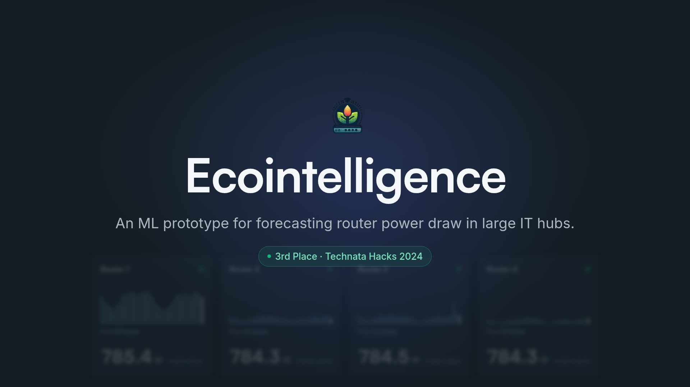
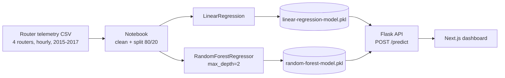
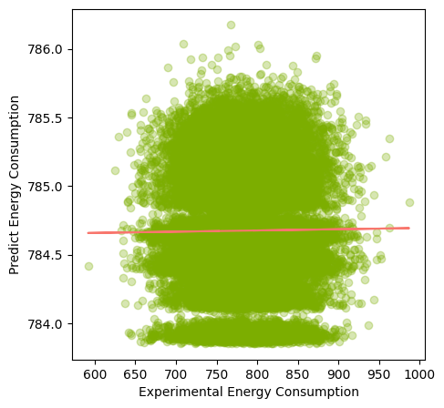
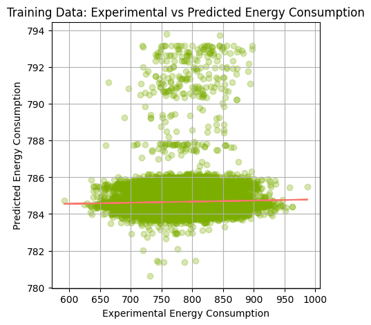

<p align="center">
  
</p>

<p align="center">
  
  
  
  
  
</p>

<p align="center">
  <a href=".github/assets/ecointelligence-demo.mp4"></a>
  <br>
  <sub>▶ Click the thumbnail to watch the demo video.</sub>
</p>

# Ecointelligence - ML Router Management API

Network hardware in large IT hubs draws power around the clock, even when traffic is low, and all of that power ends up as heat. **Ecointelligence** is a hackathon prototype that uses machine learning on router telemetry to predict router power draw, so idle gear can be powered down and the heat that remains can be managed deliberately.

This repo is the **model backend**: the training notebook, two trained scikit-learn models, simulated router telemetry, and a small Flask API that serves predictions. It won **3rd place at Technata Hacks (October 2024)**.

> Frontend: [Eco-Intelligence-dashboard-TechnataHack24](https://github.com/anakafeel/Eco-Intelligence-dashboard-TechnataHack24) (Next.js dashboard).

## How it works



1. **Data.** `realistic_router_data.csv` and `simulated_router_data.csv` hold 48,120 hourly rows for 4 routers (2015-11-01 to 2017-06-30). Columns: `DateTime`, `RouterID`, `FlowBytes`, `ID`, `EnergyConsumptionW`, `HeatDissipationBTU`, `EnergySavingMode`, plus noisy and realistic variants of the power reading. The data is simulated, not captured from real hardware.
2. **Training.** The notebook trains a `LinearRegression` and a `RandomForestRegressor(max_depth=2)` to predict `EnergyConsumptionW_realistic` from four features (`RouterID`, `FlowBytes`, `ID`, `HeatDissipationBTU`) with an 80/20 train/test split.
3. **Serving.** `modelapi.py` loads both pickled models and exposes them behind one endpoint. The caller picks the model per request.

## Results from the notebook

The notebook reports these numbers on the 80/20 split:

| Model | Train MSE | Test MSE | Test R2 |
|---|---|---|---|
| LinearRegression | 1941.18 | 2001.38 | 0.00002 |
| RandomForestRegressor (max_depth=2) | 1939.54 | 2000.50 | 0.00046 |

<p align="center">
  
  
</p>

An honest reading: on this simulated dataset the four input features explain almost none of the variance in power draw (R2 near zero, predictions cluster near the mean of about 785 W). The models are a working end-to-end pipeline (data, training, serialization, serving), not a validated energy-saving system. The notebook does not measure an end-to-end power reduction, so this repo makes no claim about percent savings. Better features (rolling traffic windows, hour of day) and a model that predicts traffic first are the obvious next steps.

## API

Base URL when running locally: `http://127.0.0.1:5000`

| Method | Path | Description |
|---|---|---|
| `GET` | `/` | Health/welcome string |
| `POST` | `/predict` | Predict power draw (W) from 4 features |

`POST /predict` body:

| Field | Type | Notes |
|---|---|---|
| `input` | list of 4 numbers | `[RouterID, FlowBytes, ID, HeatDissipationBTU]`, in that order |
| `model` | string, optional | `"linear"` (default) or `"random_forest"` |

Real request and response, captured from the running server:

```bash
curl -s -X POST http://127.0.0.1:5000/predict \
  -H 'Content-Type: application/json' \
  -d '{"input": [1, 15, 20151101001, 2676.03], "model": "random_forest"}'
```

```json
{
  "prediction": [
    785.0764596398265
  ]
}
```

Wrong feature count returns HTTP 400:

```json
{
  "error": "Invalid number of features. Expected 4, got 2."
}
```

## Quick start

Requires Python 3.10-3.12. The pinned `numpy`/`scipy` versions have no wheels for Python 3.14, so use an older interpreter.

```bash
git clone https://github.com/anakafeel/Technata-24-AI_router_Management_System.git
cd Technata-24-AI_router_Management_System
python3.12 -m venv venv && source venv/bin/activate
pip install -r requirements.txt
python modelapi.py          # serves on http://127.0.0.1:5000
```

The server runs Flask in debug mode and CORS is enabled for all origins, which suits local development with the dashboard. Put it behind `gunicorn` (already in `requirements.txt`) with CORS restricted before any real deployment.

To retrain, open `AI_Router_Management_Systeml.ipynb` in Jupyter or Colab. It reads the CSV from this repo's raw GitHub URL and re-exports both `.pkl` files.

## Project structure

```
.
├── modelapi.py                         # Flask API (GET /, POST /predict)
├── AI_Router_Management_Systeml.ipynb  # data prep, training, evaluation, plots
├── linear-regression-model.pkl         # trained LinearRegression
├── random-forest-model.pkl             # trained RandomForestRegressor
├── realistic_router_data.csv           # training data (used by the notebook)
├── simulated_router_data.csv           # sibling dataset, same schema
├── requirements.txt
└── .github/assets/                     # banner and notebook charts
```

## Related

- Dashboard (Next.js + Tailwind): [Eco-Intelligence-dashboard-TechnataHack24](https://github.com/anakafeel/Eco-Intelligence-dashboard-TechnataHack24)

## Author

**Saim Hashmi** - Computer Systems Engineering, Carleton University. Built at Technata Hacks 2024 (3rd place); commit history in this repo is under Saim's name.
GitHub: [@anakafeel](https://github.com/anakafeel)
